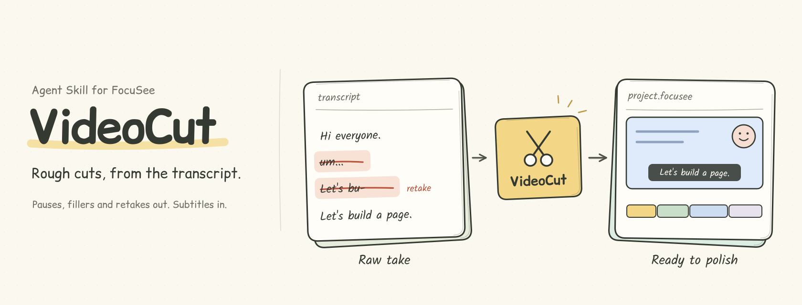

<p align="center">
  
</p>

# VideoCut

**English** · A Claude Code skill that rough-cuts [FocuSee](https://focusee.imobie.com/) screen recordings from the transcript. It transcribes the recording with word-level timestamps, cuts pauses by measured silence, removes filler words and retakes (Claude decides which take to keep and writes down why), proofreads the subtitles in context, and writes the cut list and subtitles straight back into the `.focusee` project. A local review page lets you restore or add cuts by editing the transcript like a document, and even reorder sentences. Then you open the project in FocuSee and polish as usual. Windows only; speech recognition uses Alibaba Cloud Bailian `fun-asr`.

**中文** · 让 Claude Code 按逐字稿粗剪 FocuSee 录屏工程：自动剪掉气口、语气词、口误重录，按语境校对字幕，写回 `.focusee` 工程；再用本地网页像改文档一样审阅调整（还能调换前后顺序），最后回 FocuSee 精修导出。

## 它做什么

1. 抽取工程音频，用阿里百炼 `fun-asr` 识别出带词级时间戳的文字（保留「嗯」「啊」这类语气词）。
2. **按实测静音剪气口**：用 ffmpeg 测出真正没声音的区间（阈值按底噪和人声电平自适应），超过 0.3s 的剪掉、保留约 0.18s 呼吸；切点放在波形最安静处，不剪进轻声的句尾字。孤立的「嗯/呃」、没人声也没操作的空片段一起剪掉。
3. Claude 读转写文本做语义判断：重录、说一半重来、口误只保留最后完整的一遍，每条都写理由；和录制时的鼠标点击/按键重叠的剪辑默认不启用，交给你确认。
4. Claude 逐句校对字幕错字（同音字、多出来的字），并把专有名词统一改成标准写法，直接改好不用你确认。依据按顺序是：录屏画面上写的（本地 OCR 识别屏幕文字）→ 读音对得上 → 你的用词习惯；都定不了就保留原词，不乱换。出现过的术语记进全局术语表，下次识别时作为热词提交给 fun-asr，越用越准。
5. 写回工程：剪辑写入 `playTracks`，字幕写入 FocuSee 自带的字幕轨（每行 ≤16 字，按标点/停顿/语义断句），位置自动放在录屏窗口里、贴着窗口底边（按画布比例计算）。每次写入都会先备份。
6. 摄像头美颜：FocuSee 没有人脸美颜，所以直接处理摄像头录像（磨皮、祛斑祛痘、匀肤、美白、祛法令纹、小脸、窄脸，默认参数在 `assets/beauty_preset.json`，可以换成自己的），按原时间戳重新编码，原文件留作 `webcam-0.original.mp4`，随时可还原。
7. 打开本地审阅页（可切到「逐字稿」视图，像改文档一样选中删除、双击改字）：播放剪后效果并叠加字幕预览，按字幕或时间轴还原/追加剪辑，保存即写回工程。
8. 调换前后顺序：逐字稿里拖句首的 ⠿ 把一句话挪到别处，剪后预览立刻按新顺序播放。FocuSee 本身会把片段按时间排回去，所以点「生成调序工程」后，会把录屏、摄像头、声音、鼠标轨迹按新顺序重新拼一份，另存为 `<原名> 调序.focusee`，原工程不动。

9. 章节：Claude 读逐字稿按内容分章并起标题，审阅页里可以改标题、拖动分界、增删章节；时间按剪后成片（含调换顺序）自动换算，导出 `00:00 开场` 这样的时间戳列表（工作目录里的 `chapters.txt`，页面上也能一键复制），直接贴进 B 站 / YouTube 简介。FocuSee 工程里没有章节字段，所以章节不写进工程。

剪辑逻辑参考了 [screen-studio-editor](https://github.com/oil-oil/screen-studio-editor) 的思路（音频证据自动剪、语义交给 agent、画面操作保护），章节参考了 [oil-subtitle](https://github.com/oil-oil/oil-subtitle) 的做法（按字幕划分少量宽粒度章节），代码都是重新写的。

FocuSee 里原有的缩放、标注、你手动剪过的部分都不会被破坏。

## 环境要求

- Windows + FocuSee（已在工程格式 trackVersion 2.3.0.3 上验证）
- [Claude Code](https://claude.com/claude-code)
- [uv](https://docs.astral.sh/uv/)（脚本依赖自动安装）
- ffmpeg / ffprobe 在 PATH 里
- 美颜脚本用 Python 3.12 + mediapipe（uv 第一次运行时自动下载，约几百 MB）
- 阿里云百炼 API Key：在百炼控制台创建后，在 PowerShell 里运行一次（然后重开终端/会话）：

  ```powershell
  setx DASHSCOPE_API_KEY "你的key"
  ```

  注意：识别时音频会上传到阿里云百炼临时存储，按识别时长计费。

## 安装

```powershell
git clone https://github.com/flyl1u/VideoCut.git
cd VideoCut
# 把 skill 链接到全局，在任何文件夹打开 Claude Code 都能用
New-Item -ItemType Junction -Path "$env:USERPROFILE\.claude\skills\videocut" -Target "$PWD\.claude\skills\videocut"
```

只在这个仓库里用的话可以跳过最后一步：在仓库目录打开 Claude Code，skill 就会自动加载。

## 用法

在 Claude Code 里直接说：

> 帮我粗剪最新的 FocuSee 工程

或者指定工程：

> 粗剪 D:\FocuSee\FocuSee Projects\xxx.focusee，气口留短一点，摄像头也美颜一下

也可以输入 `/videocut` 明确调用。Claude 会按 [SKILL.md](.claude/skills/videocut/SKILL.md) 的流程跑完，并打开审阅页。之后可以接着口头改，比如「第 30 句别剪」「把『写出来的东西』那句挪到最前面，生成调序工程」。

**写入前请先在 FocuSee 里关掉这个工程**（最好退出 FocuSee），写完再重新打开，否则 FocuSee 可能用旧状态覆盖。

## 还原

每次写入都会在工程文件夹里留下 `configure.focuseeproj.bak-时间戳`。想回到某个版本，把它复制回 `configure.focuseeproj` 即可。美颜过的摄像头画面用 `uv run .claude/skills/videocut/scripts/beauty.py --project <工程> --restore` 换回原样。第一次处理前的原样文件还另存在 `%LOCALAPPDATA%\videocut\<工程名>-<hash>\original.focuseeproj`。调序工程是另存的新工程，原工程本来就没动。

## 目录

```
.claude/skills/videocut/
  SKILL.md               Claude 的操作流程
  scripts/fsproj.py      工程读写、区间运算、录制操作事件
  scripts/transcribe.py  抽音频 + 百炼 fun-asr
  scripts/audio.py       实测静音、波形安静点
  scripts/analyze.py     自动剪辑方案 + agent 计划/重录/还原/字幕校对/调序记录/章节
  scripts/chapters.py    章节：成片时间换算、导出时间戳 chapters.txt
  scripts/subtitles.py   字幕断句与校对文字对齐
  scripts/apply.py       写回 playTracks 和字幕（带备份）
  scripts/make_proxy.py  审阅用低清预览视频
  scripts/screen_text.py 录屏画面 OCR（本地），给专有名词校对当证据
  scripts/beauty.py      摄像头美颜（mediapipe 人脸关键点 + OpenCV）
  scripts/reorder.py     调换顺序：按新顺序重拼素材，另存为「调序」新工程
  scripts/review_server.py  本地审阅服务（只监听 127.0.0.1）
  assets/review.html     审阅页
  assets/beauty_preset.json  默认美颜参数
assets/readme/           README 首图（scene.cjs 是源文件）
tests/                   单元测试：uv run --no-project python -m unittest discover -s tests -v
```

## License

[MIT](LICENSE)
